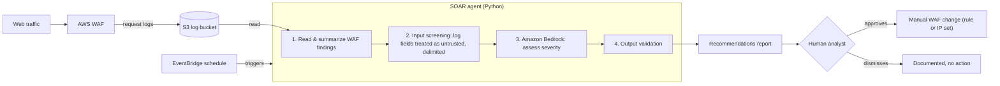

# AI Agents

Two AI agents support this project. Both run on **Amazon Bedrock**, and both are built on the same rule: **the AI advises, a person decides.** Neither agent can change infrastructure on its own.

---

## 1. AI-Powered SOAR Agent

Security orchestration agent that reviews AWS WAF activity on a schedule, uses Bedrock to assess threat severity, and produces **recommendations** for a human analyst.

### How it works

### Step by step

| Step | What happens | Why it matters |
|---|---|---|
| **Collect** | AWS WAF writes request logs to an S3 bucket. | Durable, auditable record of every inspected request. |
| **Trigger** | An EventBridge schedule starts the agent. | Reviews run consistently, with no one needing to remember. |
| **Summarize** | The agent reads the logs and condenses them into findings (blocked rules hit, top sources, unusual patterns). | Bedrock sees a summary, not raw logs, which lowers cost and exposure. |
| **Screen** | Log fields are wrapped as clearly delimited, untrusted data and checked before reaching the model. | WAF logs contain **attacker-controlled text** (URLs, headers, user-agents). Someone could plant "ignore your instructions" in a request. |
| **Assess** | Bedrock rates severity and suggests a response. | Speeds up triage of noisy WAF data. |
| **Validate** | The model's answer is checked against an expected format before it's used. | A manipulated response can't sneak in unexpected content. |
| **Decide** | A person reviews the recommendations and makes any WAF change by hand. | **Human-in-the-loop:** the AI never blocks traffic or edits rules itself. |

### Prompt-injection defenses (OWASP LLM01)

- **Untrusted input is delimited**, so the model can tell instructions from data.
- **Input screening** before log content reaches Bedrock.
- **Output validation** before any recommendation is shown.
- **Recommend-only design:** even a fully fooled model can only produce a suggestion, never an action.

---

## 2. Private AI Reporting Agent

A Python agent on Amazon Bedrock that writes this repository's `README.md` from project data.

- **Kept private:** the agent's code lives outside this repository. Only its output is published.
- **Redaction:** AWS identifiers (account IDs, ARNs, resource IDs) are removed before publishing.
- **OWASP LLM01 defenses:** delimited untrusted input, input screening, and output validation that blocks images, raw HTML, and unapproved links.
- **Tested before use** against deliberate prompt-injection attempts.

---

## Design principles shared by both agents

1. **Advise, don't act.** AI output is a recommendation or a draft, never a change.
2. **Treat every input as untrusted.** Logs, files, and data are content, never instructions.
3. **Validate every output** before a person or system uses it.
4. **Least exposure.** Send the model summaries, not raw data, and redact identifiers.
